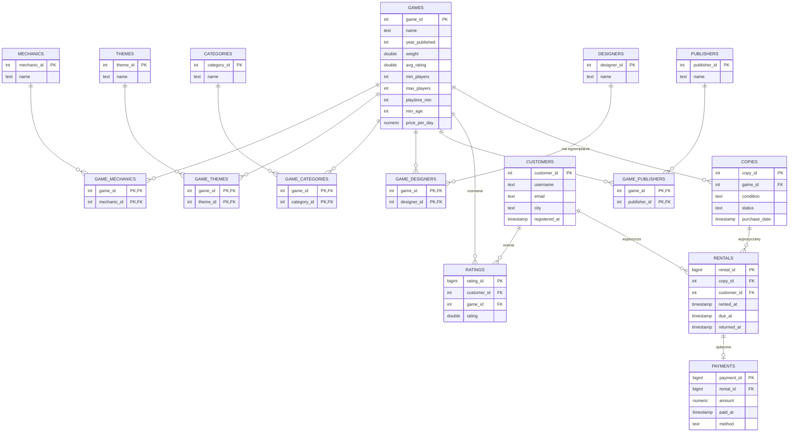

# Model danych – wypożyczalnia gier planszowych

Źródło: zbiór BoardGameGeek (`C:\Studia\Zaawansowane_bazy_danych`).
Tabele `copies`, `rentals` i `payments` są generowane programowo (stałe ziarno, więc dane są powtarzalne).

## Model relacyjny (PostgreSQL, SQLite) – 16 tabel



Skąd się biorą dane:

| Tabela | Źródło |
|---|---|
| `games` | `games.csv` (cena za dobę wyliczona z trudności gry) |
| `mechanics`, `themes`, `designers`, `publishers` + tabele łączące | `mechanics.csv`, `themes.csv`, `designers_reduced.csv`, `publishers_reduced.csv`: kolumny 0/1 zamienione na relację wiele-do-wielu |
| `categories` + `game_categories` | kolumny `Cat:*` z `games.csv` oraz `subcategories.csv` |
| `customers` | unikalni użytkownicy z `user_ratings.csv` (e-mail i miasto generowane) |
| `ratings` | równomierna próbka N wierszy z `user_ratings.csv` |
| `copies` | 1–3 egzemplarze każdej gry |
| `rentals` | N losowych wypożyczeń w latach 2022–2025, 5% jeszcze nie oddanych |
| `payments` | jedna płatność na każde oddane wypożyczenie |

## Model dokumentowy (MongoDB) – 4 kolekcje

```json
// games: dane, które w SQL leżą w 11 tabelach, są tu jednym dokumentem
{ "_id": 1, "name": "Die Macher", "weight": 4.32, "min_players": 3, "max_players": 5,
  "price_per_day": 17.96,
  "mechanics": ["Area Majority / Influence", "Auction/Bidding", ...],
  "themes": [...], "categories": ["Strategy"], "designers": ["Karl-Heinz Schmiel"], "publishers": [...],
  "copies": [ { "copy_id": 1, "condition": "good", "status": "available", "purchase_date": ISODate } ] }

// rentals: płatność osadzona w wypożyczeniu, game_id zdenormalizowane
{ "_id": 1, "customer_id": 17, "copy_id": 812, "game_id": 340,
  "rented_at": ISODate, "due_at": ISODate, "returned_at": ISODate | null,
  "payment": { "payment_id": 1, "amount": 32.5, "paid_at": ISODate, "method": "card" } }

// customers, ratings: płaskie dokumenty, tak jak w SQL
```

## Model grafowy (Memgraph) – 10 etykiet węzłów, 10 typów krawędzi

```
(:Customer)-[:MADE]->(:Rental)-[:FOR_COPY]->(:Copy)-[:COPY_OF]->(:Game)
(:Rental)-[:PAID_BY]->(:Payment)
(:Customer)-[:RATED {rating}]->(:Game)
(:Game)-[:HAS_MECHANIC]->(:Mechanic)
(:Game)-[:HAS_THEME]->(:Theme)
(:Game)-[:IN_CATEGORY]->(:Category)
(:Game)-[:DESIGNED_BY]->(:Designer)
(:Game)-[:PUBLISHED_BY]->(:Publisher)
```

Tabele łączące z SQL stają się tu zwykłymi krawędziami. Indeks `:Etykieta(id)` istnieje zawsze (odpowiednik klucza głównego).

## Indeksy pomocnicze (porównanie „bez indeksów” i „z indeksami”)

- SQL: [sql/indexes.sql](../sql/indexes.sql), 12 indeksów na kluczach obcych, datach, `username` i liczbie graczy.
- MongoDB: te same pola, w tym indeksy wielokluczowe na tablicach `mechanics` i `themes`.
- Memgraph: `:Customer(username)`, `:Rental(rented_at)`, `:Payment(paid_at)`, `:Game(min_players)`, `:Mechanic(name)`, `:Theme(name)`, `:Category(name)`.
